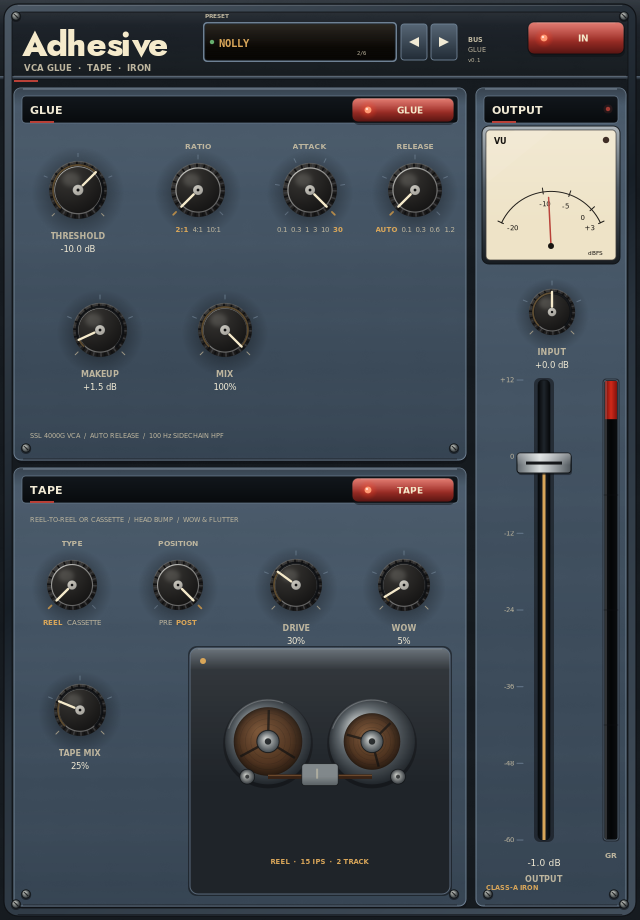
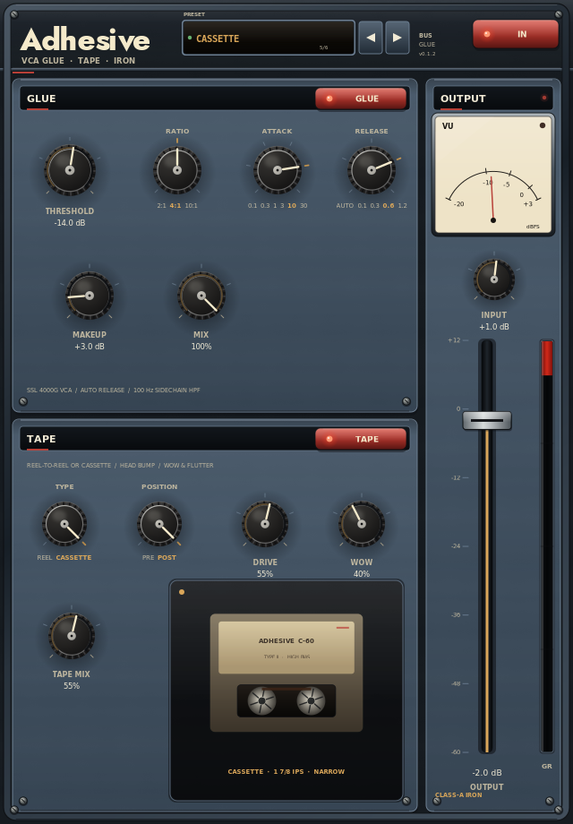

# Adhesive

[](https://github.com/tylorismusic-commits/adhesive/actions/workflows/build.yml)

**Version 0.2.0** · [GitHub](https://github.com/tylorismusic-commits/adhesive) · GPL-3.0-or-later

**Adhesive** is a free, open-source LV2 and CLAP bus processor for Linux: an SSL 4000G-inspired
VCA “Glue” compressor, a reel-to-reel or cassette tape stage that can run before or
after the compressor, and an always-on output transformer. It is the second plugin in
the Hearth family and shares the same slate-blue, cream, and red hardware language.



The tape stage has a moving transport graphic. Switch it to cassette and the reels
become a compact cassette shell with narrower bandwidth and more wow and flutter.



Adhesive is an original implementation. It is not affiliated with or endorsed by SSL,
Slate Digital, or any other manufacturer. The Glue section follows the control set and
behaviour of the classic 4000G bus compressor; the tape section is a from-scratch
magnetic model inspired by the sound of a well-set-up 15 ips two-track machine.

## Features

- **Glue — SSL 4000G-style VCA bus compressor**
  - Stepped ratio: **2:1 / 4:1 / 10:1**
  - Stepped attack: **0.1 / 0.3 / 1 / 3 / 10 / 30 ms**
  - Stepped release: **0.1 / 0.3 / 0.6 / 1.2 s + Auto**
  - Program-dependent **Auto** release
  - Fixed **100 Hz** side-chain high-pass
  - Soft knee, stereo-linked detector, parallel **Mix**
  - Threshold, makeup, and gain-reduction metering
- **Tape**
  - **Reel-to-reel** (wide, clean, 15 ips character) or **cassette**
    (narrower, darker, more wow and flutter)
  - Runs **before or after** Glue
  - Record pre-emphasis, low-frequency head bump, odd-order magnetic saturation
    with first-order ADAA, playback bandwidth limiting, and modulated wow/flutter
  - Parallel **Tape Mix**
  - Animated transport: spinning reels or cassette hubs
- **Always-on output transformer** — a subtle iron stage (core lift, a touch of
  second harmonic, gentle top-end roll-off) that is in circuit even when Glue and
  Tape are bypassed. Only the master bypass skips it.
- **Constant 4 ms latency** — the tape transport delay is always present and the dry
  path is delayed to match, so switching tape in and out does not move the audio in
  the host. The latency is reported through an LV2 latency port.
- **Hidden output protection** — a soft clipper with a +0.2 dBFS ceiling. It is
  linear below the knee, so normal programme material is untouched.
- **Working preset bar** — five musical presets plus one deliberately broken one,
  applied directly through the LV2 UI so they work in hosts that ignore `.ttl`
  presets.
- **Resizable, HiDPI-aware native X11 UI** with Jost ExtraBold wordmark, original
  knob artwork, brushed-metal texture, glass VU, and a moving tape transport.
- **Host gain-reduction metering** — the LV2 build draws GR in Ardour's mixer
  through the Harrison inline-display extension. The CLAP build reports GR
  through `clap.gain-adjustment-metering`, so REAPER can draw it on the track
  meter.

## Signal flow

```
input trim
   │
   ▼
[ tape, if PRE ] ──► Glue ──► [ tape, if POST ] ──► output transformer
                                                        │
                                                        ▼
                                                   output fader
                                                        │
                                                        ▼
                                             +0.2 dBFS soft clipper
                                                        │
                                                        ▼
                                             master bypass crossfade
```

The tape stage always runs, even in bypass, because its 4 ms transport delay is part
of the plugin latency. The master bypass crossfades to a dry path delayed by the same
amount.

## Presets

Use the `<` and `>` buttons next to the LCD, or click the LCD itself. An asterisk in
the display means the preset has been edited.

| Preset | Intent |
| --- | --- |
| **Mix Bus Glue** | Gentle 2:1 SSL-style glue with a little reel tape after the compressor |
| **Nolly Mixbus** | Subtle 15 ips reel character, low wow/flutter, and 1–3 dB of bus glue |
| **Drum Bus Smash** | Tape into a 4:1 glue stage for a punchy, saturated drum bus |
| **Vocal Sheen** | Medium glue with a clean reel pass for a vocal bus or backing stack |
| **Cassette Demo** | Narrow, warbly cassette colour with a firm glue stage |
| **Broken Machine** | Cassette before a pinned 10:1 compressor, full wow, and hot iron |

The same six presets are also provided as LV2 preset resources for hosts that support
them.

## Controls

### Glue

- **Threshold** — −30 to 0 dB. Lower thresholds compress more.
- **Ratio** — 2:1 for transparent bus glue, 4:1 for moderate control, 10:1 for a
  harder, more audible character.
- **Attack** — 0.1 to 30 ms. Slow attacks let transients through; fast attacks clamp
  them.
- **Release** — 0.1 to 1.2 s, or **Auto** for a program-dependent multi-stage
  recovery.
- **Makeup** — 0 to 20 dB.
- **Mix** — parallel blend from dry to fully compressed.

### Tape

- **Type** — reel or cassette.
- **Position** — **PRE** feeds tape into Glue; **POST** tapes the compressed signal.
- **Drive** — record-side saturation, 0–100 %.
- **Wow** — wow and flutter depth, 0–100 %.
- **Tape Mix** — parallel blend between the aligned dry signal and the tape path.

### I/O

- **Input** — −20 to +20 dB trim.
- **Output** — output fader.
- **IN / BYPASS** — master bypass. Bypass skips Glue, Tape, the transformer, and the
  output clipper; it still preserves the reported latency. It is separate from
  the host's own FX bypass.

## Gain reduction metering

- **Ardour** — use the LV2 build. Ardour draws a live GR bar in the mixer strip
  using the Harrison inline-display extension.
- **REAPER** — use the CLAP build and select **CLAP: Adhesive (Tylor)**. Enable
  **Display gain reduction for plug-ins that support it** in
  *Preferences > Appearance > Track/Send Defaults* (for new tracks) or
  right-click the track meter and enable it for an existing track. The red GR
  bar then appears on the track meter.
- The LV2 build also publishes GR on its `gr_meter` output port for generic
  hosts and automation.

## Skins

The swatch or `SKIN` chip in the plugin header cycles the suite skin. The free
Classic theme is built in. Additional skins can be installed in
`~/.local/share/hearth/skins/<skin>/` with a `palette.ini`; the selection is
shared across the Hearth suite and stored in `~/.config/hearth/skins.conf`.
Skins change only the UI colors and artwork, never the audio or project state.

## Build

Dependencies on Debian/Ubuntu:

```sh
sudo apt install build-essential cmake pkg-config \
  lv2-dev libcairo2-dev libx11-dev libfreetype6-dev \
  liblilv-dev libxtst-dev xvfb

CLAP headers are vendored in `third_party/clap` (MIT), so no external CLAP SDK is
required.
```

Configure, build, test, and install:

```sh
cmake -S . -B build -DCMAKE_BUILD_TYPE=Release
cmake --build build -j2
ctest --test-dir build --output-on-failure
cmake --install build
```

The default install prefix is `/usr/local`, so the LV2 bundle lands in
`/usr/local/lib/lv2/adhesive.lv2` and the CLAP build in
`/usr/local/lib/clap`. To install into your user folders:

```sh
cmake -S . -B build -DCMAKE_BUILD_TYPE=Release \
  -DCMAKE_INSTALL_PREFIX="$HOME/.lv2" \
  -DLV2_DIR="$HOME/.lv2" -DCLAP_DIR="$HOME/.clap"
cmake --build build -j2
cmake --install build
```

The bundle contains:

```
adhesive.lv2/
  adhesive.so
  adhesiveUI.so
  adhesive.ttl
  manifest.ttl
  presets.ttl
  knob.png
  metal.png
  Jost-ExtraBold.ttf
  OFL.txt
```

The CLAP build is produced next to it:

```
~/.clap/Adhesive.clap
~/.clap/Adhesive.resources/
  adhesiveUI.so
  knob.png
  metal.png
  Jost-ExtraBold.ttf
  OFL.txt
```

## Tests

The build includes four tests:

- **DSP** — compressor gain reduction, tape-off alignment, cassette bandwidth, the
  always-on transformer, master bypass, pre/post routing, extreme settings, and
  multiple sample rates.
- **Host** — loads the installed bundle with lilv, checks the port count, presets,
  latency port, finite audio, near-unity flat chain, and bypass.
- **UI** — embeds the X11 UI under Xvfb, loads a preset, drags a control, clicks a
  switch and the master bypass, and captures a screenshot.
- **CLAP** — loads the built CLAP, processes audio, checks that gain reduction is
  reported through `clap.gain-adjustment-metering`, and verifies that the X11 UI
  embeds in a host window.

## License

Adhesive is free software: you can redistribute it and/or modify it under the terms
of the **GNU General Public License, version 3 or later**. See [LICENSE](LICENSE).

The Jost font is licensed under the SIL Open Font License 1.1; its license is
included as `assets/fonts/OFL.txt`. The knob and metal textures are original artwork
generated by the scripts in `assets/` and are included under GPL-3.0-or-later. The
CLAP headers in `third_party/clap` are MIT-licensed; see
`third_party/clap/LICENSE.md`.
